# Hybrid HIDS/NIDS Monitoring Platform

**GNS3 Network Security Lab | OSPF · MPLS · RSVP · FortiGate · VoIP · Nagios · ELK**

Academic network engineering project developed at the **École Nationale d’Ingénieurs de Tunis (ENIT)**, Université de Tunis El Manar (2025–2026). The project implements a virtualized, multi-segment network combining routing, quality of service, firewall policies, availability monitoring, and centralized security-event analysis.

> **Project scope:** Although the report uses the name *HIDS/NIDS*, the documented implementation focuses on network/service monitoring and log analysis. It does not demonstrate a separately deployed signature-based IDS or dedicated host intrusion detection agent.

## Full GNS3 network topology

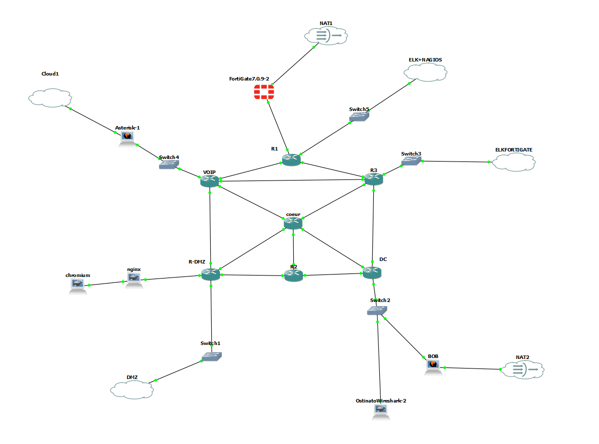

*Figure 2.1 from the project report — complete simulated network topology.*

The lab connects backbone routers and several service domains, including a **VoIP segment**, a **web DMZ**, **monitoring hosts**, and a **FortiGate firewall**. It uses OSPF dynamic routing, MPLS forwarding and RSVP configuration for voice traffic.

### VoIP traffic path

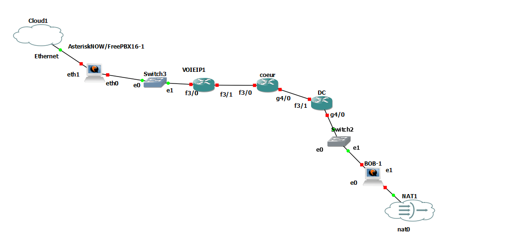

*Figure 2.2 — Asterisk/FreePBX and VoIP client communication path.*

### DMZ segment

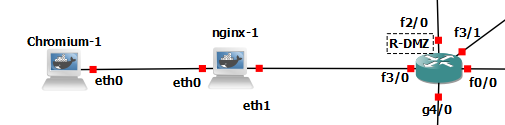

*Figure 2.25 — web server and client within the DMZ test environment.*

## Project objectives

- Emulate a realistic infrastructure using **GNS3** and **VMware Workstation**.
- Connect network segments through **OSPF** and **MPLS**.
- Configure **RSVP** and evaluate VoIP QoS before and after its activation.
- Implement **Asterisk/FreePBX** SIP calling and a test **Nginx** server in the DMZ.
- Enforce traffic restrictions with **FortiGate** and access control lists.
- Supervise routers using **Nagios**, **ICMP**, **SNMP**, and **Syslog/rsyslog**.
- Collect and inspect logs with **Filebeat**, **Elasticsearch**, **Logstash**, and **Kibana**.

## Technology stack

| Component | Tools and protocols |
| --- | --- |
| Network lab | GNS3, VMware Workstation |
| Routing and traffic engineering | OSPF, MPLS, RSVP, DSCP |
| Voice service | Asterisk, FreePBX, SIP, RTP, MicroSIP, Linphone |
| QoS testing | Wireshark, MTR |
| Web service | Nginx, HTTP, DMZ |
| Security policies | FortiGate, firewall rules, ACL |
| Network supervision | Nagios, ICMP, SNMP, Syslog, rsyslog |
| Log management | Filebeat, Elasticsearch, Logstash, Kibana, SCP, cron |

## Implementation and screenshots

### 1. VoIP service and QoS

The VoIP lab uses **Asterisk/FreePBX**, with **Alice (extension 101)** registered through MicroSIP and **Bob (extension 2002)** through Linphone. SIP registration and calling were verified, followed by RTP analysis in Wireshark.

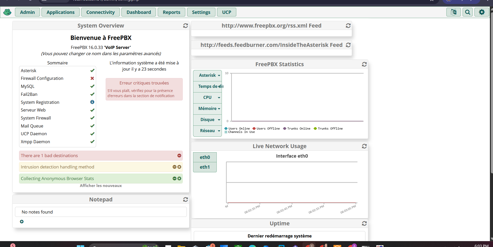

**VoIP traffic capture (without RSVP)**


**RTP jitter behavior, before versus after RSVP**

| Without RSVP | With RSVP |
| --- | --- |
| 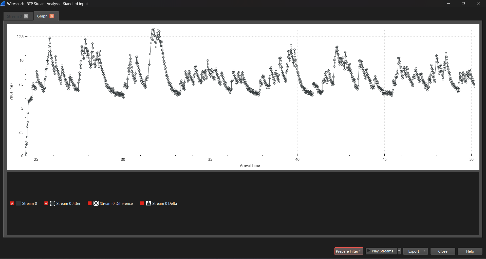 | 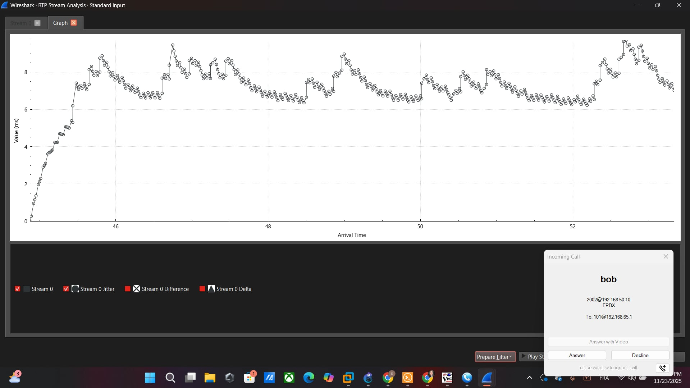 |

The report's final comparative analysis records:

| Metric | Without RSVP | With RSVP |
| --- | ---: | ---: |
| Maximum RTP jitter | 23.37 ms | 13.35 ms |
| Maximum inter-packet delta | 215.12 ms | 49.04 ms |
| MTR delay standard deviation | 11.7 ms | 7.0 ms |
| Observed RTP packet loss | 0% | 0% |

*These values are reported for this simulated test scenario; they are not generalized guarantees of RSVP performance.*

### 2. Nginx service in the DMZ

An Nginx server is deployed in the DMZ with static IP **192.168.1.4**. Connectivity was tested from a client browser before the default landing page was replaced with a project-specific page.

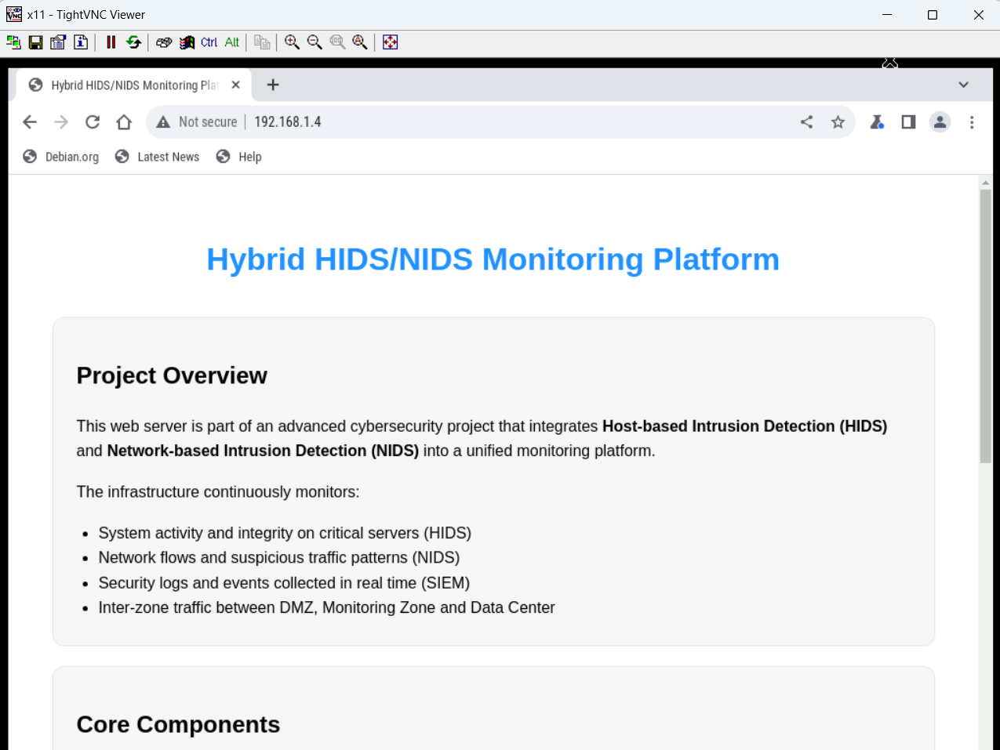

### 3. FortiGate firewall rules

FortiGate policies were configured and tested to restrict selected traffic, including access to the test destination **8.8.8.8** and SIP-related traffic associated with the Asterisk server (**192.168.50.10**, TCP/UDP 5060). The report documents connectivity checks before and after applying the relevant firewall rules.

### 4. Nagios network supervision

A Nagios VM (**192.168.50.20**) monitors network devices using ICMP and SNMP. Interface shutdown tests generated monitoring alerts. Router events were forwarded to rsyslog over UDP 514 and organized into log files.

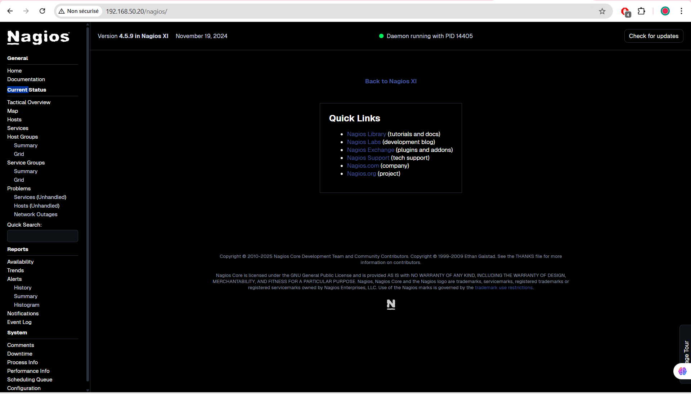

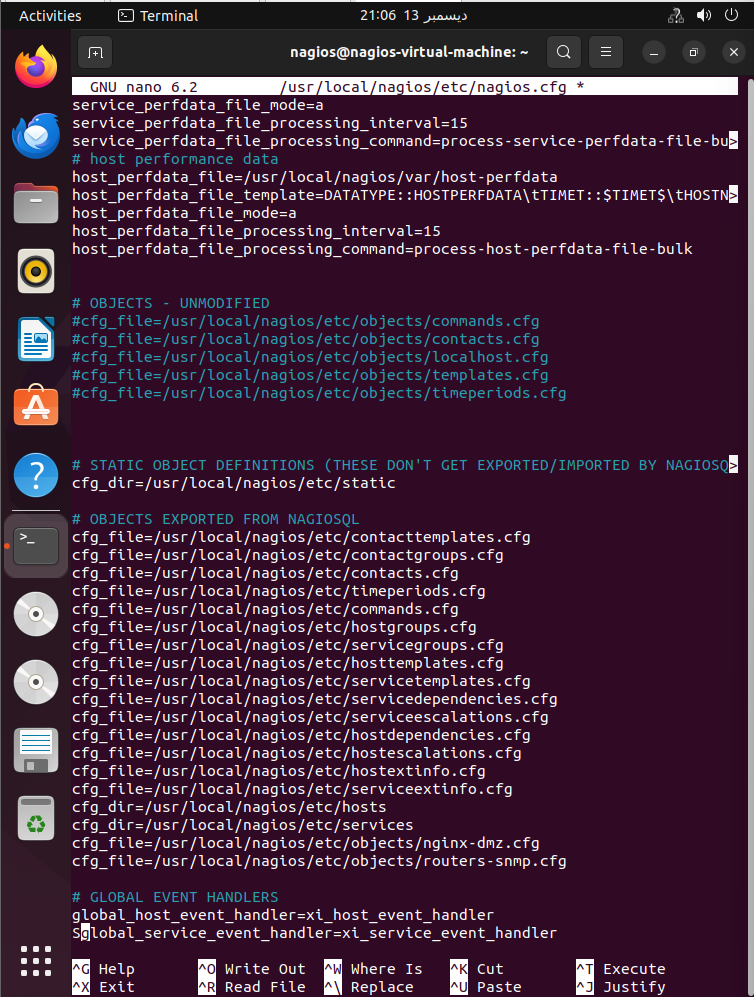

### 5. ELK and security-event visibility

An ELK VM (**192.168.50.30**) is used for log indexing and inspection. Nagios events are collected with Filebeat; the report also presents an alternate SCP transfer mechanism scheduled with cron. FortiGate logs are collected, processed using Logstash, indexed by Elasticsearch, and visualized in Kibana.

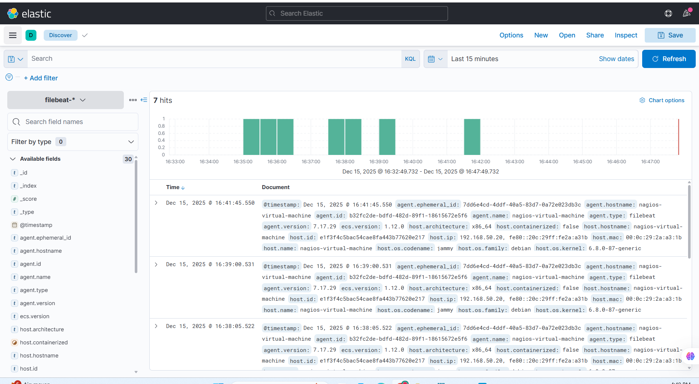

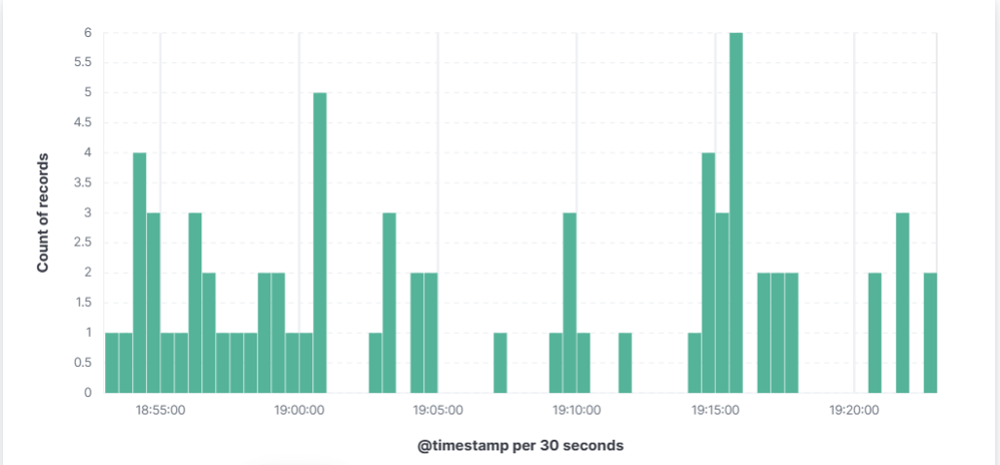

**FortiGate traffic visualization in Kibana**

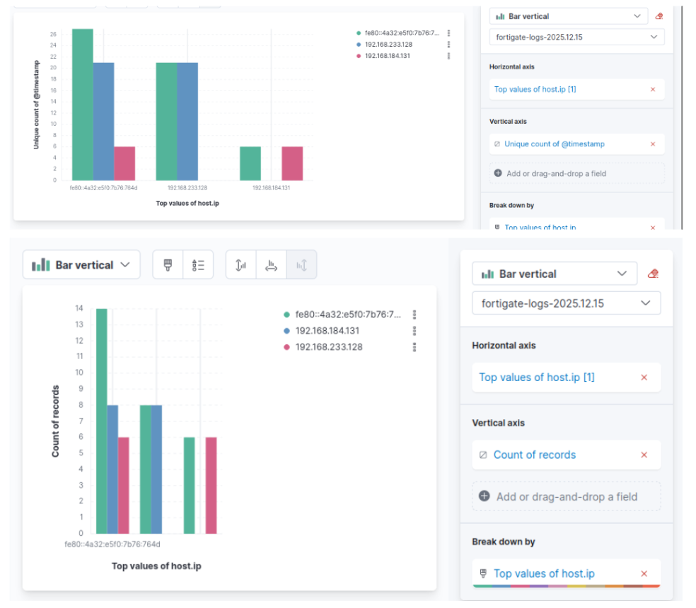

## Validation performed

- GNS3 topology connectivity and OSPF/MPLS network interconnection.
- SIP client registration, Asterisk/FreePBX calls and RTP packet capture.
- Before/after RSVP comparison of jitter, latency variation and packet timing.
- Nginx reachability and customized HTTP page in the DMZ.
- FortiGate filtering tests on selected Internet and SIP-related traffic.
- Nagios ICMP/SNMP status checks, including simulated interface failures.
- Router Syslog generation, receipt and storage with rsyslog.
- Filebeat/Elasticsearch indexing and Kibana visualization of Nagios and FortiGate events.

## Repository structure

```text
cloud-security-hids-nids-platform/
├── README.md
├── docs/
│   └── images/          # Screenshots extracted from the project report
└── project-files/        # GNS3/configuration artifacts, if included
```

## Publishing notes

The large `project-files/captures/R1_FastEthernet00_to_INTERNET_nat0.pcap` file (~2.29 GB) must **not** be committed directly to GitHub. Exclude packet captures and confidential settings. Suggested `.gitignore` entries:

```gitignore
*.pcap
*.pcapng
.env
.env.*
*.pem
*.key
```

Review any shared screenshots and configuration files for credentials, SIP secrets, private keys and sensitive information before publishing.

## Project 
Supervisor: **Mme Imene Elloumi**  
**ENIT — Université de Tunis El Manar | 2025–2026**

---

*Documentation and figures are based on the supplied project report, “Intégration d’une solution de détection d’intrusions (HIDS/NIDS).”*
